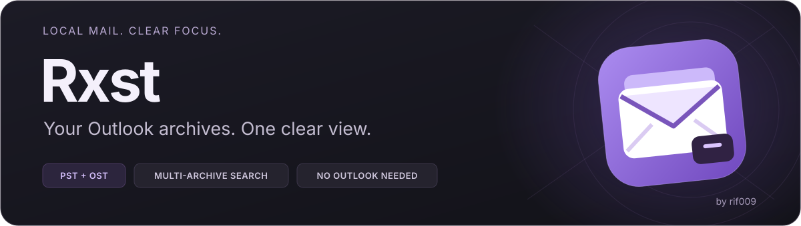
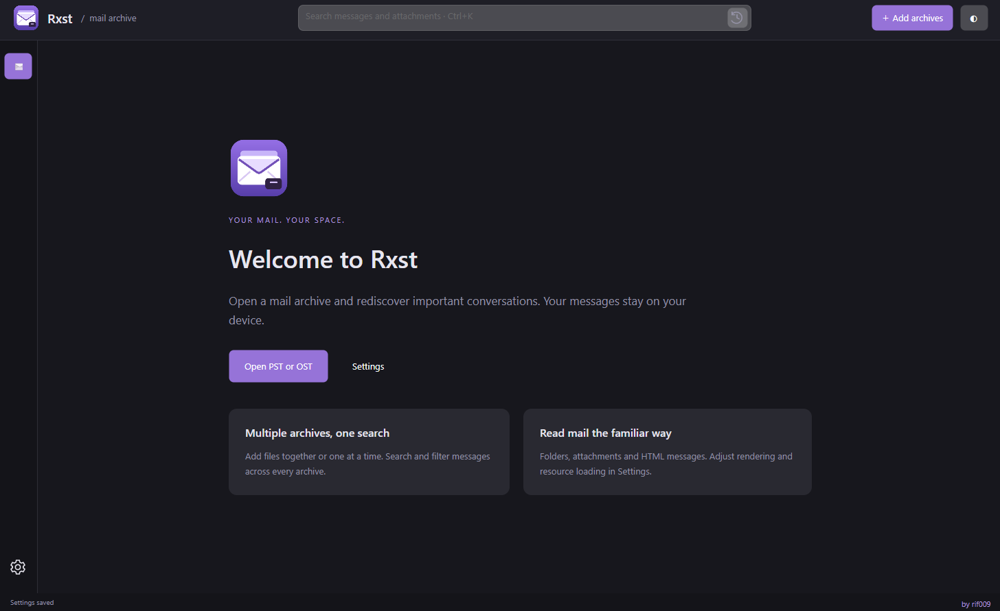

<p align="center">
  
</p>

<h1 align="center">Rxst — Outlook PST &amp; OST Viewer</h1>

<p align="center">
  <strong>Open your email archives. Find the conversation. Keep your data local.</strong><br>
  A modern, read-only Outlook archive viewer built with .NET 10 and Avalonia UI.
</p>

<p align="center"><strong>English</strong> · <a href="README.ru.md">Русский</a></p>

<p align="center">
  <a href="https://github.com/Rif009/Rxst/releases"></a>
</p>

<p align="center">
  <a href="https://github.com/Rif009/Rxst/releases">All releases</a> · <a href="#features">Features</a> · <a href="#quick-start">Quick start</a> · <a href="#search-your-mail">Search</a> · <a href="#build-from-source">Build</a> · <a href="LICENSE">MS-PL license</a>
</p>

---

**Rxst lets you open Outlook PST and OST files without installing Microsoft Outlook.** Browse local email archives, search across several mailboxes, read messages and save attachments in a familiar three-pane interface.

Looking for a **PST viewer**, an **OST reader**, or a way to **open an Outlook archive without Outlook**? Rxst works directly with supported local archive files. Source archives are opened read only, and no email account sign-in is required.

<p align="center">
  
  <br><sub>Actual Rxst interface. English and Russian are available in Settings.</sub>
</p>

## Features

| | What you can do |
| :--- | :--- |
| **Multiple archives, one view** | Open several PST/OST files at once. Check the archives to include, then browse, search and filter their messages together. |
| **Full-text email and attachment search** | Search headers, message bodies and attachment names together. Enable local indexing of attached documents in Settings. Combine field operators and quoted phrases. |
| **Smart search suggestions** | Get operator descriptions and examples as you type. Choose with arrows, Enter/Tab or a click; existing filters and quoted values are preserved. |
| **Useful filters** | Combine unread status, attachments, sender and an inclusive date range. Sort by date, sender or subject. |
| **Readable messages** | View formatted HTML and RTF messages or switch to plain text. Embedded images are supported. |
| **Clear attachment cards** | Recognize common file types by their icons, see readable file sizes and save the files you need. |
| **Message export** | Save an individual message as UTF-8 text or its original HTML/RTF/TXT body format. Export MAPI properties to CSV. |
| **Local search history** | Reuse completed queries from the search box. Keep 0–100 searches, with 5 by default, or clear the history in Settings. |
| **Make it yours** | The first launch follows your system UI language: Russian for Russian locales, English otherwise. Your manual language choice is saved. Choose a dark, light or system theme and adjust the message text size. |
| **One Windows executable** | The self-contained `Rxst.exe` includes .NET Runtime and application libraries. No separate .NET installation is required. |

## Quick start

1. Visit **[GitHub Releases](https://github.com/Rif009/Rxst/releases)** and download `Rxst.exe` from the release assets.
2. Run the application on **Windows x64**.
3. Choose **Open PST or OST** or **Add archives**. You can select several files in the dialog.
4. Check archive names on the left. **All messages in selected archives** displays their combined contents.
5. Enter a query, apply filters, select a message or save an attachment.

Right-click an archive and choose **Close archive** to remove it from the workspace without deleting the file.

> The published executable is for **Windows x64**. Linux and macOS builds have not yet been validated or published by this project.

## Search your mail

Search updates as you type. All terms must match.

Type `bo`, `att` or `co` to see field suggestions with descriptions and examples. Choose with **↑/↓**, insert with **Enter/Tab** or a click, and close with **Esc**. **Ctrl+Space** opens suggestions again. Completion changes only the operator under the caret and preserves the rest of your query. Disabled search fields are marked in the suggestions.

| Query | Finds |
| :--- | :--- |
| `invoice` | Matching text in headers, bodies and attachment names; also document contents when enabled. |
| `from:Anna` | Messages whose sender contains “Anna”. |
| `to:Alex` | Messages whose recipient field contains “Alex”. |
| `subject:"project plan"` | The phrase “project plan” in the subject. |
| `from:Anna subject:"project plan"` | Both conditions together. |
| `body:"payment approved"` | A phrase inside the message body. |
| `attachment:report` | Attachment names containing “report”; `filename:` is an alias. |
| `content:"total amount"` | Text inside attached documents (enable file content search first). |
| `from:Anna attachment:xlsx content:2026` | Sender, attachment name and extracted content together. |

In **Settings → Content search**, select searchable fields, case sensitivity and whole-word matching. Set attachment size (1–100 MB), text limits (10,000–2,000,000 characters per body and combined attachments), a per-file timeout (1–60 seconds) and excluded extensions. Defaults: bodies and names enabled; file contents disabled; 20 MB, 500,000 characters and 10 seconds.

Indexing runs in the background for the current folder or selected archives. Results expand while the first pass runs. A persistent local SQLite FTS5 trigram index reuses extracted text on reopening; changes to an archive or extraction settings invalidate its cached data. Rebuild or delete the index in Settings. Deleted data is not automatically re-indexed until you rebuild or change the archive/folder scope.

Supported attachment text: PDF with a text layer, DOCX/DOCM, XLS/XLSX/XLSM/XLSB, PPTX/PPTM, ODT/ODS/ODP, EPUB, RTF, HTML, text, CSV and common source-code files. Scans, images (OCR), legacy DOC/PPT, encrypted files and nested archives are not extracted; filenames remain searchable. Unsupported, oversized and excluded files are counted as skipped; parser failures and timeouts are counted as errors. Each file parser runs in a separate instance of the same executable and is terminated on timeout.

Use **×** to clear the query and the **history icon** to reuse a saved search. Press **Enter** to save a completed query; leaving or clearing the field saves it too. Partial keystrokes are not recorded individually.

| Shortcut | Action |
| :--- | :--- |
| `Ctrl+O` | Add one or more archives. |
| `Ctrl+K` | Focus the search field. |
| `Esc` | Leave Settings or reset mail filters. |

## Local data and settings

- Archives are opened **read only**. Browsing and filtering do not change the source files.
- Settings, search history and the extracted-text index are stored locally in your user profile. Index data contains readable email/document text; **Delete search index** removes it. Content search makes no network requests.
- External images and styles are **disabled by default**. Enabling them may let a sender know that a message was opened.
- Scripts in email HTML are not executed. Embedded images and external resource loading have separate controls.
- Set history capacity to **0** to disable it. Reducing capacity removes older saved queries.

## FAQ

### How do I open a PST file without Outlook?

Download Rxst, click **Add archives** and select a `.pst` file. Browse Outlook folders, read email, search messages and save attachments without installing Outlook.

### Can I read an OST file offline?

Rxst reads supported local `.ost` files directly. Browsing does not need an Exchange connection. Compatibility depends on the archive format and condition; encrypted S/MIME messages cannot currently be decrypted.

### Does search include the email body?

Yes. Bodies and attachment names are searchable by default. Enable **Search inside attached files** in Settings to index supported document contents too. Use `body:`, `attachment:` or `content:` to narrow the field.

### Which export formats are available?

Export individual messages as UTF-8 text or their original HTML/RTF/TXT body format. Export MAPI properties to CSV and save file attachments separately.

### What are the current limitations?

HTML rendering supports traditional email layouts, including tables, but is not a full web browser. Modern CSS Grid/Flexbox, scripts, nested CSS imports and CSS background-image downloads are not supported. Opening embedded email attachments and bulk folder export are not implemented. Damaged or unsupported archives may fail to open.

## Build from source

Requires **.NET SDK 10**. Run from the repository root:

```powershell
dotnet build XstReader.slnx -m:1
dotnet run --project src/XstReader.App
```

Publish the self-contained, single-file Windows x64 executable:

```powershell
.\tools\publish.ps1
```

Output: **`artifacts/Rxst-single/Rxst.exe`**. The script verifies that the publish directory contains exactly one file. Native libraries are extracted automatically to .NET's temporary cache on startup.

Run checks, optionally supplying your own test archives:

```powershell
dotnet run --project tests/XstReader.Checks
dotnet run --project tests/XstReader.Checks -- "D:\Mail\sample.pst" "D:\Mail\sample.ost"
```

See the [detailed development notes in Russian](docs/DEVELOPMENT.ru.md) for architecture, local settings paths and validation details.

## Credits and license

Created by **rif009**. The archive reader is based on **[Dijji/XstReader](https://github.com/dijji/XstReader)**, ported to .NET 10 with a new Avalonia UI. The visual style takes inspiration from Obsidian and Outlook's familiar mail layout.

Distributed under the **[Microsoft Public License (MS-PL)](LICENSE)**. Original copyright notices are preserved. See [third-party notices](THIRD-PARTY-NOTICES.md) for dependencies and attribution.

<p align="center"><sub>Rxst · Local mail. Clear focus. · <a href="https://github.com/Rif009/Rxst">by rif009</a></sub></p>

