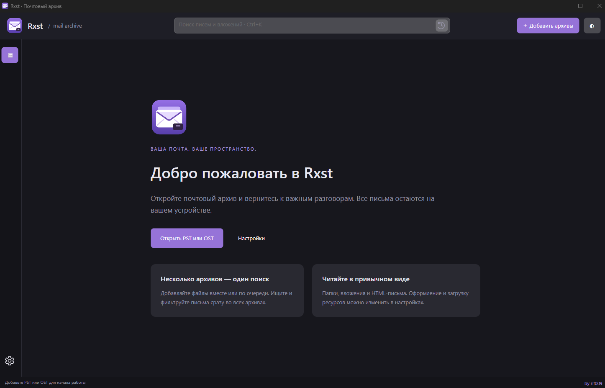

<p align="center">
  
</p>

<h1 align="center">Rxst — просмотр архивов Outlook PST и OST</h1>

<p align="center">
  <strong>Откройте почтовый архив. Найдите нужный разговор. Сохраните данные у себя.</strong><br>
  Современная программа для чтения архивов Outlook на .NET 10 и Avalonia UI.
</p>

<p align="center"><a href="README.md">English</a> · <strong>Русский</strong></p>

<p align="center">
  <a href="https://github.com/Rif009/Rxst/releases"></a>
</p>

<p align="center">
  <a href="https://github.com/Rif009/Rxst/releases">Все релизы</a> · <a href="#возможности">Возможности</a> · <a href="#быстрый-старт">Быстрый старт</a> · <a href="#поиск-писем">Поиск</a> · <a href="#сборка-из-исходников">Сборка</a> · <a href="LICENSE">Лицензия MS-PL</a>
</p>

---

**Rxst позволяет открыть архив Outlook без установки Microsoft Outlook.** Открывайте файлы **PST и OST**, просматривайте почтовые папки, ищите письма сразу в нескольких архивах и сохраняйте вложения в привычном трёхпанельном интерфейсе.

Если вы ищете, **как открыть PST без Outlook**, **чем открыть OST-файл** или как просмотреть старый почтовый архив, Rxst работает напрямую с поддерживаемыми локальными файлами. Архивы открываются только для чтения; вход в почтовую учётную запись не требуется.

<p align="center">
  
  <br><sub>Настоящий интерфейс Rxst. Русский и английский языки переключаются в настройках.</sub>
</p>

## Возможности

| | Что можно делать |
| :--- | :--- |
| **Несколько архивов — одна выдача** | Открывать несколько PST/OST одновременно. Отмечать архивы флажками и вместе просматривать, искать и фильтровать их письма. |
| **Полнотекстовый поиск писем и вложений** | Искать по заголовкам, тексту писем и названиям вложений одновременно. Включать индексацию содержимого документов в настройках. Сочетать операторы полей и фразы в кавычках. |
| **Умные подсказки поиска** | Видеть описания операторов и примеры при наборе. Выбирать стрелками, Enter/Tab или мышью; сохранять остальные фильтры и значения в кавычках. |
| **Полезные фильтры** | Совмещать непрочитанные, вложения, отправителя и диапазон дат включительно. Сортировать по дате, отправителю или теме. |
| **Читаемое содержимое** | Просматривать HTML- и RTF-письма с оформлением или переключаться на текст. Поддерживаются встроенные изображения. |
| **Наглядные вложения** | Узнавать популярные форматы по значкам, видеть понятный размер и сохранять нужные файлы отдельно. |
| **Экспорт писем** | Сохранять отдельное письмо в UTF-8 TXT или исходном формате тела HTML/RTF/TXT. Выгружать свойства MAPI в CSV. |
| **Локальная история поиска** | Повторять запросы из верхнего поля. Хранить от 0 до 100 запросов, по умолчанию 5, и очищать историю в настройках. |
| **Настройка под себя** | При первом запуске язык определяется настройками системы: русский для русской локали, английский для остальных. Выбранный вручную язык сохраняется. Доступны тёмная, светлая и системная темы, настройка размера текста писем. |
| **Один EXE для Windows** | Автономный `Rxst.exe` содержит .NET Runtime и библиотеки приложения. Отдельная установка .NET не нужна. |

## Быстрый старт

1. Перейдите в **[раздел Releases](https://github.com/Rif009/Rxst/releases)** и скачайте `Rxst.exe` из файлов релиза.
2. Запустите приложение на **Windows x64**.
3. Нажмите **«Открыть PST или OST»** либо **«Добавить архивы»**. В диалоге можно выбрать несколько файлов.
4. Отметьте архивы флажками слева. **«Все письма выбранных архивов»** объединяет их содержимое.
5. Введите запрос, включите фильтры, выберите письмо или сохраните вложение.

Чтобы закрыть архив, нажмите правой кнопкой по его имени и выберите **«Закрыть архив»**. Файл останется на диске.

> Готовый EXE предназначен для **Windows x64**. Сборки для Linux и macOS в этом проекте пока не опубликованы и не проверены.

## Поиск писем

Выдача обновляется при вводе. Все условия запроса применяются одновременно.

Начните набирать `bo`, `att` или `co` — появятся подсказки полей с описаниями и примерами. Выбор — **↑/↓**, вставка — **Enter/Tab** или щелчок мышью, закрытие — **Esc**. **Ctrl+Space** снова открывает подсказки. Дополняется только оператор под курсором, остальные условия запроса сохраняются. Выключенные области поиска отмечены в подсказках.

| Запрос | Что найдётся |
| :--- | :--- |
| `договор` | Совпадения в заголовках, тексте писем и именах вложений; в содержимом документов — после включения в настройках. |
| `from:Анна` | Письма, у которых поле отправителя содержит «Анна». |
| `to:Иван` | Письма, у которых поле получателя содержит «Иван». |
| `subject:"план проекта"` | Фраза «план проекта» в теме. |
| `from:Анна subject:"план проекта"` | Оба условия одновременно. |
| `body:"оплата согласована"` | Фраза в тексте письма. |
| `attachment:отчёт` | Названия вложений со словом «отчёт»; `filename:` — синоним. |
| `content:"общая сумма"` | Текст внутри документов (сначала включите поиск по содержимому файлов). |
| `from:Анна attachment:xlsx content:2026` | Отправитель, имя вложения и извлечённый текст одновременно. |

В **«Настройки → Поиск по содержимому»** можно выбирать области поиска, учёт регистра и целые слова, ограничивать размер вложения (1–100 МБ), объём текста (10 000–2 000 000 символов отдельно для тела и для всех вложений письма), время обработки одного файла (1–60 секунд) и исключать расширения. По умолчанию включены текст писем и имена вложений, содержимое файлов выключено; лимиты — 20 МБ, 500 000 символов и 10 секунд.

Индексация идёт в фоне для текущей папки или выбранных архивов. При первом проходе результаты постепенно дополняются. Локальный индекс SQLite FTS5 с триграммами сохраняет извлечённый текст для повторного открытия; изменение архива или параметров обработки обновляет кэш. Индекс можно перестроить или удалить в настройках. После удаления повторная индексация начнётся при перестроении или изменении выбранных архивов/папки.

Поддерживается извлечение текста из PDF с текстовым слоем, DOCX/DOCM, XLS/XLSX/XLSM/XLSB, PPTX/PPTM, ODT/ODS/ODP, EPUB, RTF, HTML, TXT, CSV и популярных форматов исходного кода. Сканы, изображения (OCR), старые DOC/PPT, зашифрованные файлы и вложенные архивы не распознаются; поиск по имени сохраняется. Неподдерживаемые, большие и исключённые файлы учитываются как пропущенные, сбои обработки и тайм-ауты — как ошибки. Каждый файл разбирается в отдельном процессе того же приложения, который завершается при превышении времени.

Кнопка **×** очищает строку, а **значок истории** открывает сохранённые запросы. **Enter** сохраняет завершённый запрос; он также сохраняется при уходе из поля или очистке строки. Промежуточные символы при наборе не записываются отдельно.

| Сочетание | Действие |
| :--- | :--- |
| `Ctrl+O` | Добавить один или несколько архивов. |
| `Ctrl+K` | Перейти в строку поиска. |
| `Esc` | Выйти из настроек или сбросить фильтры писем. |

## Локальные данные и настройки

- Архивы открываются **только для чтения**: просмотр и фильтрация не меняют исходные файлы.
- Настройки, история и индекс извлечённого текста хранятся локально в профиле пользователя. Индекс содержит читаемый текст писем и документов; кнопка **«Удалить поисковый индекс»** очищает его. Поиск по содержимому не обращается в интернет.
- Внешние изображения и стили **выключены по умолчанию**. Их можно разрешить в настройках; такие запросы могут сообщить отправителю об открытии письма.
- Скрипты в HTML-письмах не выполняются. Для встроенных изображений и внешних ресурсов есть отдельные переключатели.
- Лимит истории **0** отключает её. При уменьшении лимита удаляются старые сохранённые запросы.

## Частые вопросы

### Как открыть PST-файл без Outlook?

Скачайте Rxst, нажмите **«Добавить архивы»** и выберите `.pst`. Просматривайте папки Outlook, читайте и ищите письма, сохраняйте вложения без установки Outlook.

### Можно ли открыть OST-файл без подключения к Exchange?

Rxst читает поддерживаемые локальные `.ost` напрямую. Для просмотра архива подключение к Exchange не требуется. Совместимость зависит от формата и состояния файла; расшифровка писем S/MIME сейчас не поддерживается.

### Есть ли поиск по тексту внутри письма?

Да. Текст писем и названия вложений участвуют в поиске по умолчанию. Включите **«Искать в содержимом вложенных файлов»** в настройках, чтобы искать внутри поддерживаемых документов. Для выбора поля используйте `body:`, `attachment:` или `content:`.

### В какие форматы можно экспортировать письмо?

Отдельное письмо можно сохранить как текст UTF-8 или в исходном формате тела HTML/RTF/TXT. Свойства выгружаются в CSV, файловые вложения сохраняются отдельно.

### Какие есть ограничения?

HTML-просмотр поддерживает классическую вёрстку писем, включая таблицы, но не заменяет полноценный браузер. Современные CSS Grid/Flexbox, скрипты, вложенные CSS-импорты и загрузка фоновых CSS-изображений не поддерживаются. Открытие вложенных писем и массовый экспорт папок пока не реализованы. Повреждённый или неподдерживаемый архив может не открыться.

## Сборка из исходников

Нужен **.NET SDK 10**. Команды выполняются из корня репозитория:

```powershell
dotnet build XstReader.slnx -m:1
dotnet run --project src/XstReader.App
```

Публикация автономного EXE для Windows x64:

```powershell
.\tools\publish.ps1
```

Результат: **`artifacts/Rxst-single/Rxst.exe`**. Скрипт проверяет, что в папке публикации находится ровно один файл. Нативные библиотеки автоматически распаковываются во временный кэш .NET при запуске.

Запуск проверок, в том числе на собственных тестовых архивах:

```powershell
dotnet run --project tests/XstReader.Checks
dotnet run --project tests/XstReader.Checks -- "D:\Mail\sample.pst" "D:\Mail\sample.ost"
```

Архитектура, пути локальных настроек и подробности проверок описаны в [заметках для разработчиков](docs/DEVELOPMENT.ru.md).

## Авторство и лицензия

Автор приложения — **rif009**. Ядро чтения архивов основано на **[Dijji/XstReader](https://github.com/dijji/XstReader)**, перенесено на .NET 10 и дополнено новым интерфейсом Avalonia. Оформление вдохновлено Obsidian и привычной почтовой компоновкой Outlook.

Проект распространяется по **[Microsoft Public License (MS-PL)](LICENSE)**. Исходные уведомления об авторстве сохранены. Зависимости и атрибуция перечислены в [THIRD-PARTY-NOTICES.md](THIRD-PARTY-NOTICES.md).

<p align="center"><sub>Rxst · Ваша почта в одном месте. · <a href="https://github.com/Rif009/Rxst">by rif009</a></sub></p>

